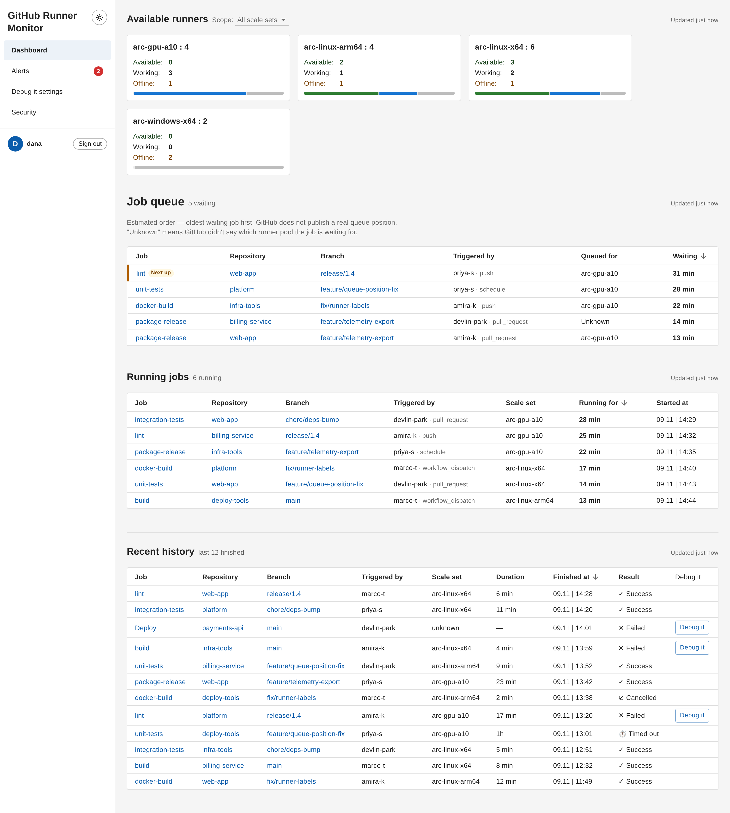
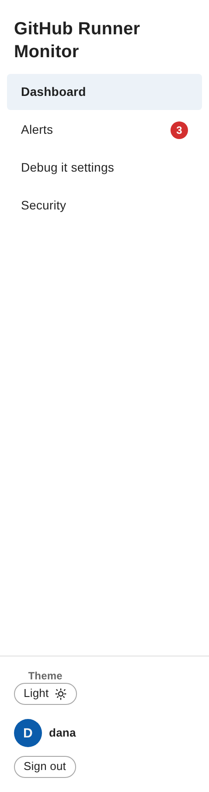
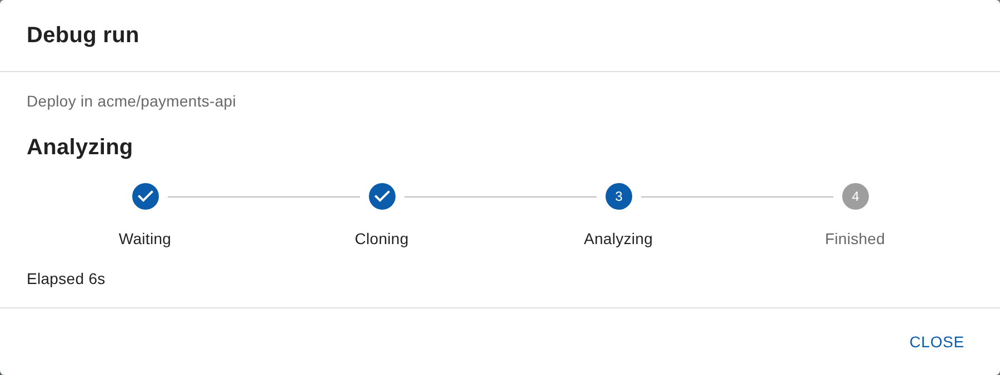
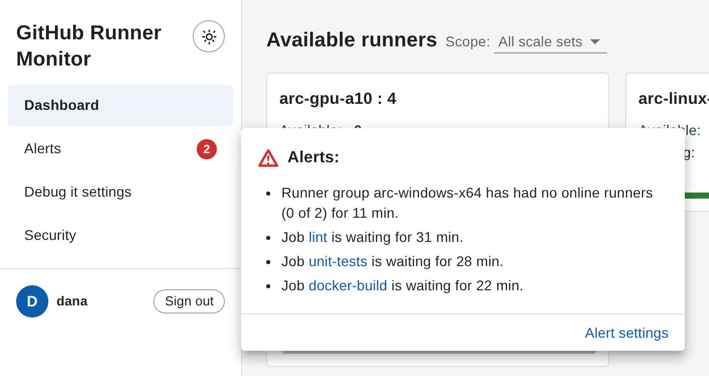
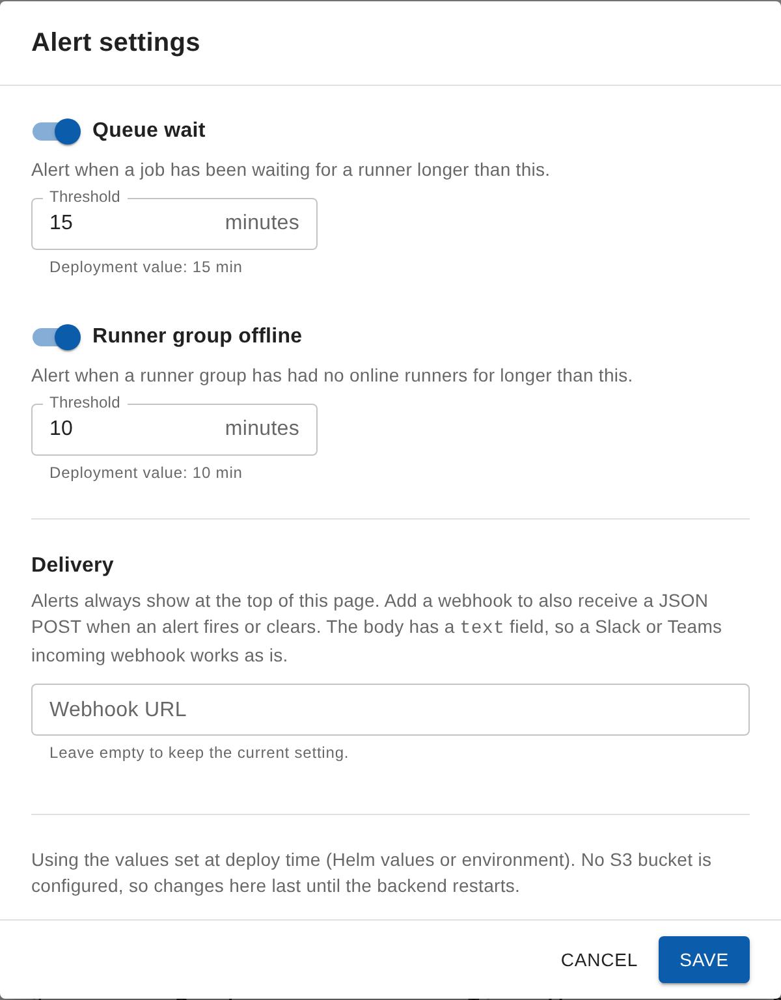
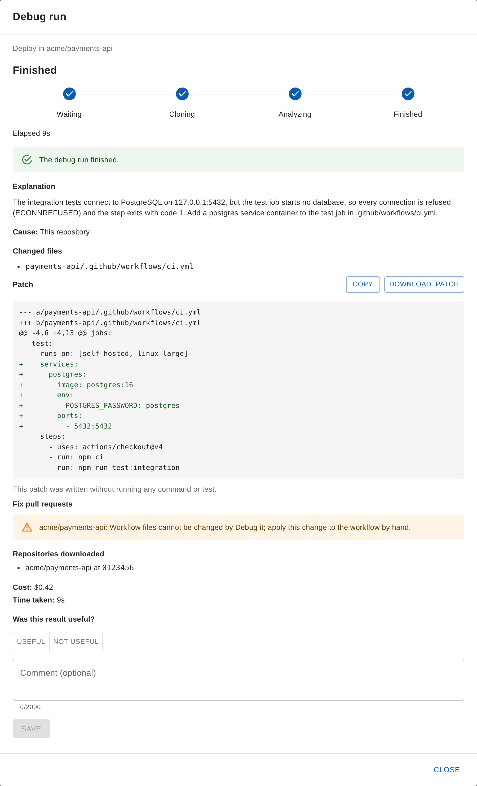
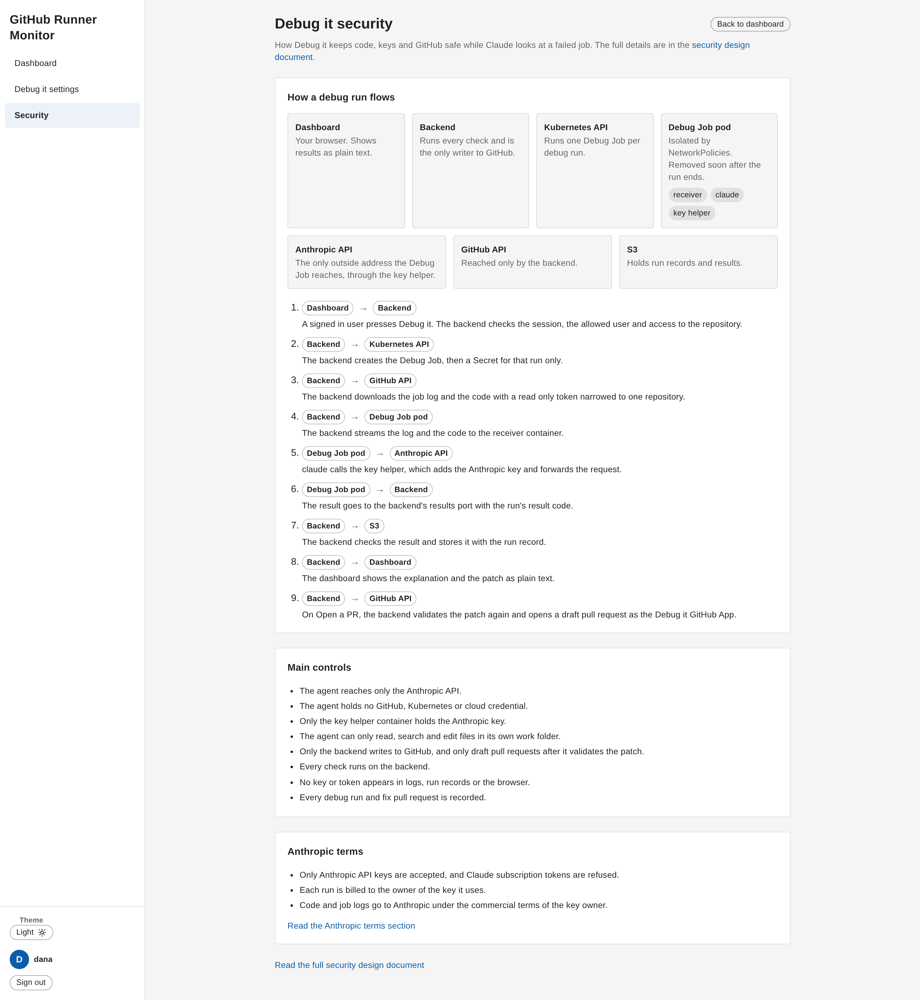

# GitHub Runner Monitor

A live dashboard for self-hosted GitHub Actions runners. It shows how many runners are free, busy or offline in each pool, which jobs are waiting and in what order, what is running now, and what finished recently. It also alerts when a job has waited too long or a runner pool has gone dark. Every job links out to GitHub for the full detail.

<details open>
<summary>Table of Contents</summary>

- [How a debug run works](#how-a-debug-run-works)
- [Run it](#run-it)
- [What it shows](#what-it-shows)
- [Alerts](#alerts)
- [Using real GitHub data](#using-real-github-data)
- [Turn on Debug it](#turn-on-debug-it)
- [Configuration](#configuration)
- [The API](#the-api)
- [Tests](#tests)
- [Changelog](#changelog)

</details>



The side panel on the left of the page, with the Dashboard item, the Alerts item (showing how many alerts are active), the Debug it settings and Security items, the theme switch and the signed in user. On a window narrower than 900 pixels it opens from the menu button in the top bar:



The repositories and people in these pictures are made up. That is the fake data the app starts with. These are the 2.x screenshots; the 1.x ones are in [docs/images/v1](docs/images/v1). What changed between versions is in [CHANGELOG.md](CHANGELOG.md).

## How a debug run works

Pressing **[Debug it](#turn-on-debug-it)** on a failed job starts a debug run, and every debug run goes through a pipeline:



- **Waiting:** while the allowed parallel runs are all taken, the run waits in the queue until one of them ends.
- **Cloning:** the backend starts an isolated Debug Job and streams to it the failed job's log and the repository's code at the failed commit.
- **Analyzing:** Claude reads the log and the code inside the Debug Job, explains why the job failed and suggests a patch, and the backend checks the result.
- **Finished:** you read the explanation and the patch and can open each validated part as a draft fix pull request.

If the run fails, the last step shows **Failed** and the reason is shown below the steps.

## Run it

You need Docker. You do not need a GitHub token, and you do not need Node installed — everything runs in containers.

From the project folder:

```bash
docker compose -f docker/docker-compose.yml up --build -d
```

Open **http://localhost:8080**.

It starts with made-up data, so it works straight away. One runner pool is deliberately full with jobs backed up behind it, so the queue has something to show, and another has every runner offline, so the alerts do too.

Debug it is on in this demo too. Compose sets `DEBUG_IT_ENABLED` to the value of `USE_MOCK_DATA` (so `true` by default) and `DEBUG_IT_PUBLIC_URL` to `http://localhost:8080`. Signing in needs no GitHub account: it always signs you in as the invented user `dana`. Click **Debug it** on a failed row in Recent history and the run moves through Waiting, Cloning and Analyzing to a fixed, invented result. No Job is created, and nothing calls Anthropic or writes to GitHub.

To stop it:

```bash
docker compose -f docker/docker-compose.yml down
```

To point it at a real organisation, copy `.env.example` to `.env` and fill it in. `.env` is ignored by git, so your token cannot be committed by accident. Docker Compose reads that file and passes the values into the backend container. Every name in it is explained in [Configuration](#configuration); you can leave the whole file alone while you are on made-up data.

To run it on Kubernetes instead, see [helm/README.md](helm/README.md).

## What it shows

- **Available runners** — each pool with its size, then how many are available, working, and offline.
- **Job queue** — every waiting job, longest wait first, with the pool each is waiting for. Jobs GitHub named no pool for say "Unknown". GitHub does not publish a real queue position, so this order is worked out from when each job was created. The page says so.
- **Running jobs** — what is on a runner at this moment and for how long.
- **Recent history** — finished jobs with pass or fail, and the time each one finished, as supporting detail.
- **Alerts** — the item in the side panel counts jobs stuck in the queue and runner pools with no online runner. Click it for the list. See [Alerts](#alerts).

A job that ran on one of GitHub's own cloud runners, rather than a self-hosted one, shows its pool as "GitHub Actions (cloud)".

Every job shows its repository and its branch in their own columns, who started it, and what triggered it, so you can find your own row among jobs that otherwise look identical. The organisation name is left off the repository — every repository on the page belongs to the same one. The job name, the repository and the branch each link out to github.com in a new tab. A job whose branch GitHub did not report says "unknown" instead, with nothing to click.

Click any column heading to sort the table by that column, and click it again to reverse it. Sorting only reorders rows — nothing is hidden.

The job queue and running jobs tables show 10 rows at a time and recent history shows 20, with previous/next arrows underneath and a "Show all" button that lists every row on one page instead.

The job tables refresh themselves every 15 seconds and the Available runners panel every 30 seconds, and again whenever you switch back to its browser tab after being away. There is no manual refresh button — each section says on its own heading line how old its data is, so you can see whether it is current.

The page shows the numbers and leaves the reading of them to you. It does not add sentences explaining what the numbers mean. There is no log view.

## Alerts

Two alerts watch for trouble so you do not have to keep reading the tables:

- **Jobs stuck in the queue** — a job has been waiting for a runner longer than the queue wait threshold (15 minutes unless you change it). There is one alert per pool, listing its stuck jobs longest first, each linking to GitHub. Jobs with no known pool get their own "unknown pool" alert.
- **Runner group offline** — a pool has had no online runner for longer than the offline threshold (10 minutes unless you change it). A pool that vanishes from GitHub's runner list altogether counts too, for up to 7 days after it was last seen. If GitHub cannot be reached, offline alerts are left as they were instead of being raised or cleared on missing data.

The **Alerts** item in the side panel shows how many alerts are active, and so does the browser tab title. Click it for the list: one line per stuck job and one per offline group, offline groups first, 10 lines per page. The backend checks every 30 seconds whether or not anyone has the page open.



### Changing the thresholds

The starting values come from the deployment — the `ALERT_*` variables below, set in Helm values or `.env`. After that, anyone with the page open can change them from **Alert settings** in the Alerts window (open it with **Alerts** in the side panel): turn each alert on or off, change its threshold in minutes, and set or remove a webhook.



A change made in the dialog wins over the deployment value for that setting, and settings nobody changed keep following the deployment. **Reset to deployment values** removes the dialog's changes. With `JOB_STATE_S3_BUCKET` set, changes are saved to that bucket (at `ALERT_STATE_S3_KEY`) as soon as you press Save, so they survive a restart, the same way the job list does. Without a bucket they last until the backend restarts, and the dialog says so. Set `ALERT_SETTINGS_EDITABLE=false` to make the dialog read-only and keep the deployment values fixed.

### Webhook

By default alerts are shown on screen only. Add a webhook URL and the backend also POSTs JSON to it once when an alert fires and once when it clears — not on every check:

```json
{
  "source": "github-runner-monitor",
  "event": "alert.fired",
  "text": ":warning: 2 jobs have waited longer than 15 minutes for arc-gpu-a10",
  "alert": { "id": "queue_wait:arc-gpu-a10", "kind": "queue_wait", "scaleSet": "arc-gpu-a10", "message": "…", "since": "…", "jobs": ["…"] },
  "sentAt": "2026-09-27T12:00:00.000Z"
}
```

`event` is `alert.fired` or `alert.resolved`. The `text` field means a Slack or Microsoft Teams incoming webhook can take it as is. **Send test** in the dialog posts a test message. The dialog only ever shows the webhook's host, since the rest of such a URL is usually the secret, and it shows the last delivery's result.

The dashboard has no login, so anyone who can open the page can change where the webhook points. If that matters where you run it, set the webhook from Helm and set `ALERT_SETTINGS_EDITABLE=false`. With Debug it enabled, only Debug it administrators (signed in, with the CSRF token) can change, reset or test the alert settings; everyone else gets 401 or 403.

## Using real GitHub data

Fake data is on by default. To point it at a real organisation, set four things before starting:

```bash
export USE_MOCK_DATA=false
export GITHUB_TOKEN=your_token_here
export GITHUB_ORGANIZATION=your_org_name
export GITHUB_WEBHOOK_SECRET=a_long_random_string

docker compose -f docker/docker-compose.yml up --build -d
```

Job data is not fetched from GitHub. GitHub posts it to this app as jobs start, run, and finish, so the organisation also needs a webhook pointing here — see below. The token is still needed, for the runner pool counts (how many runners each pool has, and how many are free) and for looking up who triggered a job and what event started it.

### What the token needs

A **fine-grained personal access token**, with the organisation itself chosen as the **resource owner** — not your own account. The self-hosted runner permission below only appears once you pick the organisation, which is the usual reason people cannot find it.

Three permissions, **all Read-only**. Nothing needs write access:

| Where in the token page | Permission | Level |
|---|---|---|
| Organization permissions | Self-hosted runners | Read-only |
| Repository permissions | Actions | Read-only |
| Repository permissions | Metadata | Read-only (GitHub selects it for you) |

Under **Repository access**, pick the repositories whose jobs you want to see, or all of them.

This is the exact set that was proved against a real organisation and it works. The application never writes anything to GitHub.

### The webhook

Where the job data comes from. Without it the queue, running and history
sections stay empty however good the token is.

Someone who owns the organisation has to do this once:

1. Make up a long random string. This is the shared secret. It is the same
   value as `GITHUB_WEBHOOK_SECRET` above, so keep it.
2. Go to **Settings → Webhooks → Add webhook** on the organisation.
3. **Payload URL**: your address plus `/api/webhooks/github`, for example
   `https://runners.example.com/api/webhooks/github`.
4. **Content type**: `application/json`.
5. **Secret**: the string from step 1.
6. **SSL verification**: leave it enabled.
7. **Which events?** Choose *Let me select individual events*, untick
   everything, and tick **Workflow jobs** and **Workflow runs**.
   Workflow jobs fills the queue, running and history sections. Workflow
   runs adds failed runs that never started a job (for example a broken
   workflow file) to Recent history. Without it the monitor behaves as
   before and simply does not show those runs. If the webhook already
   exists, edit it and tick Workflow runs as well.
8. Leave **Active** ticked and press **Add webhook**.

The webhook page then shows a **Recent Deliveries** tab. Green ticks mean
messages are arriving and being accepted.

Two things worth knowing about how this behaves:

- **The backend keeps jobs in memory, not in a database.** If it restarts, whatever it held is gone unless it was saved — hence `JOB_STATE_S3_BUCKET`. With a bucket configured, the job list is written out there periodically and read back on the next start. Without one, a restart starts the page empty and it fills up again as new jobs run.
- **GitHub never re-sends a message it delivered successfully**, and **the webhook address has to be reachable from GitHub**, which posts from its own addresses. The signature on each message, not the network, is what proves a message is genuine — the backend refuses anything unsigned or wrongly signed, and refuses everything if no secret is configured.

## Turn on Debug it

Debug it adds a **Debug it** button to failed jobs on the dashboard. A signed in user who is allowed to use it presses it, and Claude reads the job log and the repository's code in an isolated Kubernetes Job, explains why the job failed and suggests a patch. The user can then open that patch as a draft pull request. It is off by default, and with it off the chart and the backend behave exactly as 1.x. It runs only on repositories that opt in with a [debug context file](#debug-context-file). How it is kept apart from GitHub, the cluster and your secrets is described in [docs/security-design.md](docs/security-design.md).

In the demo, a finished run shows the invented explanation, the patch and what happened to the fix pull request:



The **Security** item in the side panel opens a page that sums up how a debug run flows and the main controls:



The steps below use invented names: the organization `acme`, the repository `acme/payments-api`, the dashboard address `https://runner-monitor.acme.example` and the AWS account `111122223333`. Replace them with your own. Every `debugIt` value is described in [helm/values-backend.yaml](helm/values-backend.yaml), and what the chart renders with it on is in [helm/README.md](helm/README.md#debug-it).

### Before you turn it on

What the platform owner must know:

- **Code and job logs go to Anthropic.** Each debug run sends the failed job's log and the downloaded repository code to the Anthropic API, under the commercial terms of the organization that owns the Anthropic key (in personal mode, each user's own key).
- **The Debug it App authors every fix pull request**, not the person who pressed the button. So that person can approve the pull request themselves, unless your ruleset asks for more than one approval.
- **CI starts with repository secrets when the draft opens.** The fix branch lives in your repository, not in a fork, so the workflows that run on pull requests (and on pushes to that branch) run with the repository's secrets, on code Claude suggested.

What we recommend:

1. A ruleset on the default branch that requires **two approving reviews** (step 2), so a fix pull request needs someone besides its requester.
2. A **spend limit on the Anthropic workspace** the key belongs to, on top of Debug it's own limits (`debugIt.limits`).
3. `branches-ignore: ['debug-it/**']` on workflows that run on `push`, so a fix branch (`debug-it/<run ID>/<repository>`) does not start them:

   ```yaml
   on:
     push:
       branches-ignore: ['debug-it/**']
   ```

### Steps

#### 1. Create the Debug it GitHub App

Debug it uses its own GitHub App, separate from the `GITHUB_TOKEN` the dashboard reads with. An owner of the organization creates it under **Organization settings → Developer settings → GitHub Apps → New GitHub App**:

- **GitHub App name**: for example `acme-debug-it`.
- **Homepage URL**: the dashboard address, `https://runner-monitor.acme.example`.
- **Callback URL**: `<debugIt.publicUrl>/api/debug-it/callback`, for example `https://runner-monitor.acme.example/api/debug-it/callback`. Users sign in to Debug it with this App.
- **Webhook**: untick **Active**. Debug it gets job events from the organization webhook (step 3), not from the App.
- **Where can this GitHub App be installed?**: Only on this account.

Permissions, exactly these:

| Where | Permission | Level |
|---|---|---|
| Repository permissions | Contents | Read and write |
| Repository permissions | Pull requests | Read and write |
| Repository permissions | Actions | Read-only |
| Repository permissions | Metadata | Read-only (GitHub selects it for you) |
| Organization permissions | Members | Read-only |

Never give it **Workflows**, **Administration** or **Organization administration**. The backend's startup check reads the installation's permissions and keeps Debug it off while it holds any of them.

Then:

1. **Install** the App on the organization in `GITHUB_ORGANIZATION` (`acme`), on the repositories Debug it may use, or all of them. Only members of that organization can sign in.
2. Note the **App ID** (`debugIt.githubApp.appId`) and the **Client ID** (`debugIt.githubApp.clientId`) from the App's settings page.
3. **Generate a new client secret** and keep it for step 6.
4. **Generate a private key**. GitHub downloads a `.pem` file; keep it for step 6.

Who may do what is still checked per user: starting a run needs read access to the repository, and **Open a PR** needs write access.

#### 2. Add a repository ruleset

Debug it opens a fix pull request only where a ruleset stops it from pushing to or merging into the default branch. Without one it refuses, with: *Debug it opens fix pull requests only where an active ruleset, with no bypass for Debug it, stops it from pushing to and merging into the default branch, and this repository has none.*

On each repository (for example `acme/payments-api`), or once for the organization, under **Settings → Rules → Rulesets → New branch ruleset**:

- **Enforcement status**: Active.
- **Target branches**: the default branch.
- **Require a pull request before merging**, with at least one required approval (we recommend 2). A **Restrict updates** rule also counts.
- **Bypass list**: the Debug it App must not be on it.

Classic branch protection rules do not count; Debug it reads only rulesets.

#### 3. Tick Workflow runs on the organization webhook

Debug it starts from the jobs and runs the dashboard already receives. On the organization webhook from [The webhook](#the-webhook), make sure both **Workflow jobs** and **Workflow runs** are ticked.

#### 4. Get an Anthropic API key

Create an **Anthropic API key** in the [Anthropic Console](https://console.anthropic.com/), in a workspace with a spend limit. Claude subscription tokens (those starting `sk-ant-oat` or `sk-ant-ort`, for example from `claude setup-token`) are refused.

With `debugIt.credentialsMode: personal`, each user saves their own key in the dashboard instead, and the organization key is optional.

#### 5. Create the debug namespace

The chart renders into it but does not create it:

```bash
kubectl create namespace debug-it
```

The name is `debugIt.debugNamespace` (`debug-it` by default).

#### 6. Create the Secrets

Secrets go in the release (backend) namespace, never in a values file: the App private key, the App client secret, the encryption keys and the Anthropic key, here in three Secrets in the namespace `runner-monitor`:

```bash
# The App's private key and client secret (step 1).
kubectl -n runner-monitor create secret generic debug-it-github-app \
  --from-file=privateKey=<path-to-the-app-private-key.pem> \
  --from-literal=clientSecret=<the-app-client-secret>

# The two encryption keys, 32 bytes each. The key names are fixed.
kubectl -n runner-monitor create secret generic debug-it-encryption \
  --from-literal=personalKeyEncryptionKey="$(openssl rand -hex 32)" \
  --from-literal=sessionEncryptionKey="$(openssl rand -hex 32)"

# The organization Anthropic API key (step 4).
kubectl -n runner-monitor create secret generic debug-it-anthropic \
  --from-literal=apiKey=<the-anthropic-api-key>
```

The values point at them in step 11: `debugIt.githubApp.privateKeySecret` and `debugIt.githubApp.clientSecretSecret` (`name` and `key`), `debugIt.encryptionSecret.name`, and `debugIt.anthropicApiKeySecret` (`name` and `key`). Each encryption key may also be base64 of 32 bytes or a 32 byte string, but `openssl rand -hex 32` is the simple choice. Changing `sessionEncryptionKey` signs everyone out; changing `personalKeyEncryptionKey` makes saved personal keys unreadable.

#### 7. Give the backend access to the bucket

Debug it keeps its run records under `debug-it/` in the bucket the job list already uses (`JOB_STATE_S3_BUCKET`), so that bucket is required. Turn on **bucket versioning**: Debug it deletes a record by deleting every version of it. Versioning also keeps every old version of the job list, which is written every minute, so add a lifecycle rule that expires noncurrent versions (for example after a few days).

The backend's IAM policy, with the bucket `acme-runner-monitor`:

```json
{
  "Version": "2012-10-17",
  "Statement": [
    {
      "Sid": "DebugItRecords",
      "Effect": "Allow",
      "Action": ["s3:GetObject", "s3:PutObject", "s3:DeleteObject", "s3:DeleteObjectVersion"],
      "Resource": "arn:aws:s3:::acme-runner-monitor/debug-it/*"
    },
    {
      "Sid": "DashboardState",
      "Effect": "Allow",
      "Action": ["s3:GetObject", "s3:PutObject"],
      "Resource": "arn:aws:s3:::acme-runner-monitor/github-runner-monitor/*"
    },
    {
      "Sid": "Bucket",
      "Effect": "Allow",
      "Action": "s3:ListBucket",
      "Resource": "arn:aws:s3:::acme-runner-monitor"
    },
    {
      "Sid": "DebugItVersions",
      "Effect": "Allow",
      "Action": "s3:ListBucketVersions",
      "Resource": "arn:aws:s3:::acme-runner-monitor",
      "Condition": { "StringLike": { "s3:prefix": "debug-it/*" } }
    }
  ]
}
```

The `DashboardState` resource must cover the `JOB_STATE_S3_KEY` and `ALERT_STATE_S3_KEY` in use; `github-runner-monitor/*` covers the defaults.

`s3:ListBucket` has no prefix condition: before each run the backend checks that the bucket answers (a `HeadBucket` call, which has no prefix), and without it S3 answers a missing record with 403 instead of 404.

On EKS, give the policy to a role (for example `arn:aws:iam::111122223333:role/acme-runner-monitor-backend`) and attach it with an **EKS Pod Identity association** (the cluster needs the EKS Pod Identity Agent add-on) for the backend's ServiceAccount in the release namespace: `<deployment.name>-debug-it` (`backend-debug-it` with the shipped values), or `serviceAccount.name` when `serviceAccount.enabled` is true. Other clusters give the backend pod AWS credentials their usual way.

```bash
aws eks create-pod-identity-association --cluster-name acme-eks \
  --namespace runner-monitor --service-account backend-debug-it \
  --role-arn arn:aws:iam::111122223333:role/acme-runner-monitor-backend
```

#### 8. Allow the backend's egress

If your cluster or firewall limits what the backend pod may reach, allow:

- `api.github.com` (443): the App's calls;
- `github.com` (443): sign in;
- `codeload.github.com` (443): repository downloads, which GitHub redirects to;
- GitHub's log storage hosts (443), where job log downloads are redirected: today `*.actions.githubusercontent.com` and `*.blob.core.windows.net`, which GitHub may change;
- `api.anthropic.com` (443): the Anthropic key check;
- the Kubernetes API: creating Debug Jobs and their Secrets;
- S3 (443), in `AWS_REGION`;
- Debug Job pods on 8080 in the debug namespace: the backend uploads the log and code to them;
- the telemetry collector, when `debugIt.costTelemetry` is on.

A firewall outside the cluster must also let Debug Job pods reach `api.anthropic.com` on 443, and let the nodes pull the Debug Job image (`debugIt.jobImage.repository`).

#### 9. Make sure NetworkPolicies are enforced

The chart's NetworkPolicies keep each Debug Job away from GitHub, the cloud metadata address, the Kubernetes API and everything else but Anthropic. They do nothing unless the cluster enforces NetworkPolicies. On EKS with the VPC CNI, turn on network policy support and set `NETWORK_POLICY_ENFORCING_MODE` to `strict`, so a new Debug Job pod is blocked from its first packet:

```bash
aws eks update-addon --cluster-name acme-eks --addon-name vpc-cni \
  --configuration-values '{"enableNetworkPolicy":"true","env":{"NETWORK_POLICY_ENFORCING_MODE":"strict"}}'
```

Check that the labels in `debugIt.network` (cluster DNS, frontend pods, ingress controller pods) match your cluster; see [helm/README.md](helm/README.md#debug-it).

#### 10. Allow the debug namespace in your ArgoCD project

If ArgoCD installs the backend release, its project must allow the debug namespace, since the release renders a Role, a RoleBinding and a NetworkPolicy there. ArgoCD never creates Debug Jobs; the backend does, through the Kubernetes API.

```yaml
apiVersion: argoproj.io/v1alpha1
kind: AppProject
metadata:
  name: runner-monitor
  namespace: argocd
spec:
  destinations:
  - server: https://kubernetes.default.svc
    namespace: runner-monitor
  - server: https://kubernetes.default.svc
    namespace: debug-it  # debugIt.debugNamespace
```

If the project limits resource kinds with `namespaceResourceWhitelist`, also allow `ServiceAccount`, `ConfigMap`, `Role` and `RoleBinding` (group `rbac.authorization.k8s.io`) and `NetworkPolicy` (group `networking.k8s.io`).

#### 11. Set the values and turn it on

In the backend values, next to the 1.x settings (`JOB_STATE_S3_BUCKET` set, the `GITHUB_WEBHOOK_SECRET` Secret entry kept, `deployment.autoscaling` off: Debug it runs exactly one backend pod):

```yaml
deployment:
  env:
    regular:
      GITHUB_ORGANIZATION: acme
      JOB_STATE_S3_BUCKET: acme-runner-monitor
debugIt:
  enabled: true
  credentialsMode: organization
  # GitHub numeric user IDs, not logins.
  administrators: [1000004]
  allowedUsers: [1000001]
  allowedRepositories: [acme/payments-api]
  publicUrl: https://runner-monitor.acme.example
  githubApp:
    appId: "123456"
    clientId: Iv23liExampleClientId
    privateKeySecret: { name: debug-it-github-app, key: privateKey }
    clientSecretSecret: { name: debug-it-github-app, key: clientSecret }
  encryptionSecret:
    name: debug-it-encryption
  anthropicApiKeySecret: { name: debug-it-anthropic, key: apiKey }
  debugNamespace: debug-it
  jobImage:
    repository: bialekamir/github-runner-monitor
```

Save that block as `values-acme.yaml`. To find a user's numeric ID, run `curl -s https://api.github.com/users/<login>` and read `id`. Leave `debugIt.jobImage.tag` empty to get `debug-job-v<chart appVersion>`, so install the chart from the same release tag (`vX.Y.Z`) as the `backend-vX.Y.Z` image; set `debugIt.jobImage.tag` (for example `debug-job-vX.Y.Z`) only when installing the chart from `main` before that release.

```bash
helm upgrade --install runner-monitor-backend ./helm/chart -n runner-monitor \
  -f helm/values-backend.yaml -f values-acme.yaml \
  --set deployment.image.name=bialekamir/github-runner-monitor \
  --set deployment.image.tag=backend-vX.Y.Z
```

Rendering fails, naming what is missing, if a required value is empty or a plain string stands where a Secret reference belongs. Administrators change the allowed users and repositories later in the dashboard.

#### 12. Check the startup result and add the context file

Each time the backend starts with Debug it on, it checks the App's permissions and that a test pod in the debug namespace cannot reach what a Debug Job must not reach. Debug it stays off until that passes. An administrator signs in and opens the **Debug it settings** page: it shows the result, and when Debug it is off, one sentence saying why. Fix the cause and restart the backend to check again.

Last, each repository opts in with `.github/claude-debug-context.md` on its default branch; see [Debug context file](#debug-context-file).

## Configuration

### Backend

Every setting below is an environment variable read by the backend container. The four above (`USE_MOCK_DATA`, `GITHUB_TOKEN`, `GITHUB_ORGANIZATION`, `GITHUB_WEBHOOK_SECRET`) are the ones you normally touch; the rest have working defaults and are there for tuning against a large or rate-limited organisation.

| Variable | Default | What it does |
|---|---|---|
| `USE_MOCK_DATA` | `true` | `true` serves made-up data and needs no token. Set to `false` for a real organisation. |
| `GITHUB_TOKEN` | empty | The fine-grained token described above. Required when `USE_MOCK_DATA=false`. |
| `GITHUB_ORGANIZATION` | empty | The organisation to read. Required when `USE_MOCK_DATA=false`. |
| `GITHUB_WEBHOOK_SECRET` | empty | The shared secret on the organisation webhook. Every message GitHub posts is signed with it and anything that does not match is refused. With nothing set here the webhook route refuses everything, so an unconfigured deployment fails closed. Required when `USE_MOCK_DATA=false`. |
| `JOB_STATE_S3_BUCKET` | empty | Bucket the job list is saved to, so a restart does not empty the page. Leave empty and nothing is saved or read. |
| `JOB_STATE_S3_KEY` | `github-runner-monitor/job-store.json` | The object inside that bucket. |
| `JOB_STATE_SAVE_INTERVAL_SECONDS` | `60` | How often the job list is written out. Nothing is written when nothing has changed. |
| `AWS_REGION` | `us-east-2` | Region of the S3 bucket above. |
| `ALERT_QUEUE_WAIT_ENABLED` | `true` | Whether the "jobs stuck in the queue" alert is on. Can be changed later from the page — see [Alerts](#alerts). |
| `ALERT_QUEUE_WAIT_MINUTES` | `15` | How long a job may wait for a runner before it raises an alert, in whole minutes. |
| `ALERT_RUNNER_GROUP_OFFLINE_ENABLED` | `true` | Whether the "runner group offline" alert is on. |
| `ALERT_RUNNER_GROUP_OFFLINE_MINUTES` | `10` | How long a pool may have no online runner before it raises an alert, in whole minutes. |
| `ALERT_WEBHOOK_URL` | empty | Where to POST alerts as they fire and clear. Empty means on screen only. |
| `ALERT_SETTINGS_EDITABLE` | `true` | `false` makes the alert settings read-only on the page. |
| `ALERT_STATE_S3_KEY` | `github-runner-monitor/alert-state.json` | The object in `JOB_STATE_S3_BUCKET` where alert settings changed on the page are saved. |
| `ALERT_EVALUATION_INTERVAL_SECONDS` | `30` | How often the alerts are checked. |
| `JOB_STORE_MAX_JOBS` | `5000` | Most jobs held in memory at once. |
| `JOB_STORE_MAX_AGE_DAYS` | `7` | How old a finished job may be and still show up under "recent history". |
| `JOB_STORE_STUCK_HOURS` | `12` | A job still showing as queued or running this long after it started is assumed to have had its "finished" message lost, and stops being shown as live. |
| `JOB_STORE_WARMUP_SECONDS` | `300` | After a restart that restored nothing, how long the page keeps saying some jobs may be missing. |
| `HISTORY_DEFAULT_LIMIT` | `200` | How many rows of finished-job history the API returns when a request does not ask for a specific amount. |
| `HISTORY_MAX_LIMIT` | `200` | The most history rows a request can ask for. |
| `RUNNING_MAX_ITEMS` | `200` | The most currently-running jobs the API returns. |
| `WEBHOOK_BODY_LIMIT` | `5mb` | Largest webhook message accepted. A finished job carries its whole step list and is routinely tens of kilobytes, well over Express's 100kb default. |
| `WEBHOOK_DEDUPE_SIZE` | `5000` | How many delivery ids are remembered, so a message GitHub re-sends is applied once. |
| `RUN_EXTRAS_CACHE_SIZE` | `2000` | How many workflow runs the backend remembers the event and triggering user for. |
| `RUN_EXTRAS_CONCURRENCY` | `4` | How many of those run lookups may be in flight at once. |
| `SHUTDOWN_DRAIN_SECONDS` | `5` | How long the backend keeps answering after being asked to stop, so messages already on their way are not lost. |
| `SHUTDOWN_DEADLINE_SECONDS` | `15` | How long shutdown is allowed to take in total before the backend exits anyway. |
| `GITHUB_MAX_RUNNER_PAGES` | `20` | Page limit when listing runners. A page is 100 runners. |
| `GITHUB_MAX_JOB_PAGES` | `10` | Page limit when listing the jobs of one run. |
| `GITHUB_MAX_RETRIES` | `3` | Retries for a failed GitHub request. |
| `GITHUB_BASE_DELAY_SECONDS` | `1` | First wait before a retry; it grows from there. |
| `GITHUB_MAX_DELAY_SECONDS` | `10` | Longest wait between retries. |
| `GITHUB_MAX_RETRY_WAIT_SECONDS` | `10` | Longest the app will honour a GitHub "retry after" instruction before giving up. |
| `GITHUB_RATE_LIMIT_RESERVE` | `50` | Requests kept in hand, so the app stops before it exhausts your rate limit. |
| `GITHUB_ETAG_CACHE_SIZE` | `500` | How many GitHub responses are remembered so an unchanged one can be skipped instead of re-fetched. |
| `CIRCUIT_BREAKER_FAILURE_THRESHOLD` | `5` | Failures in a row before the app stops calling GitHub for a while. |
| `CIRCUIT_BREAKER_TIMEOUT_SECONDS` | `60` | How long it stays stopped. |
| `CIRCUIT_BREAKER_HALF_OPEN_MAX_CALLS` | `3` | Test calls it makes before deciding GitHub is healthy again. |
| `CACHE_TTL_RUNNERS_SECONDS` | `30` | How long the runner list is kept before asking GitHub again, in seconds. One call returns up to 100 runners. |
| `CACHE_MAX_SIZE` | `100` | Most items held in the cache. |
| `REQUEST_BATCH_WINDOW_MS` | `100` | How long identical requests are gathered together before one is sent. |
| `MAX_BATCH_SIZE` | `10` | Most requests gathered into one batch. |
| `PORT` | `3001` | The backend port inside the container network. It is not published outside Docker. |

### Frontend

The frontend is a static site, so its settings are not read at build time — they are written into a small `config.js` file every time the container starts, from these environment variables. That means they can be changed from Helm values (or plain `docker run -e`) without rebuilding the image.

| Variable | Default | What it does |
|---|---|---|
| `APP_HEADING` | `GitHub Runner Monitor` | The title shown at the top of the page. |
| `APP_TAB_TITLE` | `Runner Monitor` | The browser tab title. |
| `APP_HISTORY_LIMIT` | `200` | How many rows of recent history the page asks the backend for. |
| `APP_HISTORY_PAGE_SIZE` | `20` | Rows per page in the Recent history table. |
| `APP_QUEUE_PAGE_SIZE` | `10` | Rows per page in the Job queue table. |
| `APP_QUEUE_MAX_ITEMS` | `200` | Most queued jobs the page will list. |
| `APP_RUNNING_PAGE_SIZE` | `10` | Rows per page in the Running jobs table. |
| `APP_RUNNERS_REFRESH_SECONDS` | `30` | How often the Available runners panel asks the backend again, in seconds. |

`docker/docker-compose.yml` only wires `APP_HEADING` and `APP_TAB_TITLE` through by default; the rest can still be set on the frontend container directly, or from the Helm chart.

### Debug context file

Debug it runs only on repositories that opt in. A repository opts in with a file at `.github/claude-debug-context.md` on its default branch; without it, or with an empty one, Debug it refuses to start and says why. The file may be up to 64 KiB and has three sections, found by their headings at any level:

- **About this repo** — what the repository builds and how its CI runs.
- **Common failures** — failures you see often, with their usual cause and fix.
- **Extra repositories** — one list item per other repository Debug it should also download, written `name` or `owner/name`, with any comment after it. At most 5 are used, all from the same organisation; any others are skipped and named in the result.

Start from [docs/debug-context/claude-debug-context.template.md](docs/debug-context/claude-debug-context.template.md), or see the filled-in [example](docs/debug-context/claude-debug-context.example.md).

### Debug Job image

Each debug run happens in a Kubernetes Job built from the image in [code/debug-job/](code/debug-job/) (node:24-alpine with Claude Code 2.1.316, running as uid 1000). It holds three small programs with no dependencies: the **receiver** (`src/receiver.ts`), which accepts the log and repository code from the backend into `/work`, keeping only regular files and folders; the **key helper** (`src/keyHelper.ts`), the only part of the Job that holds the Anthropic key, which listens on `127.0.0.1` and forwards Claude Code's requests to `api.anthropic.com`; and the **wrapper** (`src/wrapper.ts`), which the claude container runs. The wrapper first checks that GitHub, the cloud metadata address, the Kubernetes API, the backend's main port and outside DNS cannot be reached (and exits without starting Claude if any answers), then runs Claude Code with only the Read, Grep, Glob and Edit tools, a settings file that denies reading or editing anything outside `/work`, and a dummy key pointed at the key helper. It stops Claude 60 seconds before the run's deadline, diffs the edited code against an untouched copy kept outside `/work`, and posts the explanation, patch, cost and time to the backend's results port with the run's result code, printing only fixed `wrapper:` status lines.

### Cost telemetry

Debug it can report what each debug run spent to the OpenTelemetry collector behind the [claude-code-reviewer-cost](https://github.com/amir-bialek/claude-code-reviewer-cost) Grafana dashboard, so Debug it shows up next to the reviewer's Claude Code spend. It is off by default. Only the backend sends it; the Debug Job gets no new network access and no new value.

**Protocol.** The same format Claude Code's own telemetry uses: OTLP over HTTP with a JSON body, `POST {endpoint}/v1/metrics`, with the collector key (when one is set) in the `x-api-key` header. Redirects are not followed and each request gives up after 5 seconds.

**Metrics.** Two cumulative, monotonic sums, one series per repository and requester:

| OTLP metric | Unit | Data point attributes | Prometheus name (after the collector) |
|---|---|---|---|
| `claude_code.cost.usage` | `USD` | `session.id` | `claude_code_cost_usage_USD_total` |
| `claude_code.token.usage` | `tokens` | `session.id`, `type` (`input` or `output`) | `claude_code_token_usage_tokens_total{type="input"\|"output"}` |

Resource attributes: `service.name=github-runner-monitor-debug-it`, `ci.repo` (the run's repository, `owner/name`), `ci.pr_author` (the GitHub login that asked for the run) and `deployment.environment=debug-it`. In Prometheus these become the labels `ci_repo`, `ci_pr_author` and `deployment_environment` the dashboard groups by. `session.id` is a random ID per backend process, so a restart starts new series. Nothing else is sent: no explanation, patch, run ID, key or code.

**When.** A run's numbers are added when it ends from a result (finished, or failed at a limit or on an error the Debug Job reported). Runs that end without a result (a lost Job, or one stopped at its deadline before reporting) are not reported, so the dashboard's totals can be lower than the backend's usage totals. The backend sends right away when a run is recorded. From the first recorded run on, it also re-sends every series every 60 seconds, even when nothing changed. A new series' first value comes with a zero point one second earlier, so Prometheus `increase()` counts the first run. Sends go out one at a time, in order. On shutdown the backend makes one last send. If the collector cannot be reached the run is not affected: a send for a run logs one `[WARN]` line naming the run, and the regular re-send logs one `[WARN]` when it starts failing.

**Collector requirements.** An OTLP/HTTP receiver (port 4318 by default) that accepts JSON and passes the metrics to the Prometheus the dashboard reads through the `prometheusremotewrite` exporter with `resource_to_telemetry_conversion: enabled: true`, as claude-code-reviewer-cost does. That setting turns resource attributes into labels. Do not use the pull-based `prometheus` exporter: it keeps only the latest value of each series, so the zero point is lost and the first run of each series is not counted. If the backend's network is restricted, allow it to reach the collector.

**Helm values** (backend, `debugIt` block):

| Value | Default | What it does |
|---|---|---|
| `debugIt.costTelemetry.enabled` | `false` | Turns cost telemetry on. Rendering fails when it is on without an endpoint. |
| `debugIt.costTelemetry.endpoint` | `""` | The collector's base URL, for example `http://otel-collector.monitoring:4318`; `/v1/metrics` is added. |
| `debugIt.costTelemetry.apiKeySecret` | `{}` | Optional. A Secret reference `{ name, key }` holding the collector key, passed to the backend as `DEBUG_IT_COST_TELEMETRY_API_KEY`. A plain value is refused. |

The backend reads these as `DEBUG_IT_COST_TELEMETRY_ENABLED`, `DEBUG_IT_COST_TELEMETRY_ENDPOINT` and `DEBUG_IT_COST_TELEMETRY_API_KEY`. With `USE_MOCK_DATA=true` nothing is sent.

## The API

The browser only ever calls paths starting with `/api`. Nginx passes them to the backend and removes the `/api` part, so `/api/runners` arrives as `/runners`.

| Address | What it returns |
|---|---|
| `GET /api/runners` | Every runner, tagged with its pool |
| `GET /api/scale-sets` | Each pool with its total, free, busy, and offline counts (the page shows `free` as "available") |
| `GET /api/jobs/queue` | Waiting jobs in the order they will run |
| `GET /api/jobs/running` | Jobs on a runner now, longest first |
| `GET /api/jobs/history` | Recent finished jobs with their result |
| `GET /api/settings` | The runner refresh rate the Available runners heading prints, taken from `CACHE_TTL_RUNNERS_SECONDS` |
| `GET /api/alerts` | The alerts active at the last check |
| `GET /api/settings/alerts` | The alert settings in use, the deployment values, and where they came from. The webhook URL is shown masked. |
| `PUT /api/settings/alerts` | Change alert settings. Takes any of `queueWait`, `runnerGroupOffline` (`{ enabled, thresholdMinutes }`) and `webhookUrl` (`null` removes it) |
| `DELETE /api/settings/alerts` | Go back to the deployment values |
| `POST /api/settings/alerts/test` | Send a test message to the webhook |
| `POST /api/webhooks/github` | Where GitHub posts job events. Not for browser use — see [The webhook](#the-webhook). |

`/api/jobs/queue`, `/api/jobs/running`, `/api/jobs/history`, `/api/runners` and `/api/scale-sets` all accept `?scaleSet=<id>` to narrow the results to a single pool. `/api/jobs/history` also accepts `?limit=<n>`, capped by `HISTORY_MAX_LIMIT`.

```bash
curl http://localhost:8080/api/jobs/queue
```

## Tests

Backend:

```bash
cd code/backend
npm ci
npm test
```

Frontend (`npm test` starts Vitest in watch mode and never exits, so use `vitest run` instead):

```bash
cd code/frontend
npm ci
npx vitest run
```

## Changelog

What changed in each version, and what to do when upgrading, is in [CHANGELOG.md](CHANGELOG.md). Each release also creates a GitHub Release `vX.Y.Z` holding that version's section of the changelog and its major version's screenshots.

The screenshots for a major version live in `docs/images/vN` (`v1` for 1.x, `v2` for 2.x). They are taken from the demo with [docs/images/capture-screenshots.mjs](docs/images/capture-screenshots.mjs), a Playwright script that is run by hand, not in CI; its first lines say how.

### Releasing a new version

Every merge to `main` is a release, so every pull request sets a new version `X.Y.Z`, higher than the one on `main`, in these places:

1. `helm/chart/Chart.yaml`: `version: X.Y.Z` and `appVersion: X.Y.Z`.
2. `helm/values-backend.yaml`: `tag: backend-vX.Y.Z`.
3. `helm/values-frontend.yaml`: `tag: frontend-vX.Y.Z`.
4. `CHANGELOG.md`: a new `## X.Y.Z` section at the top.
5. For a new major version N only: its screenshots in `docs/images/vN`.

For example, after `v2.1.0` a fix is `2.1.1` and a new feature is `2.2.0`. PR Validate fails until all of these match and the version is higher than the one on `main`. After the merge, Release Publish pushes the images `backend-vX.Y.Z`, `frontend-vX.Y.Z` and `debug-job-vX.Y.Z` to `bialekamir/github-runner-monitor`, tags the commit `vX.Y.Z` and creates the GitHub Release.
