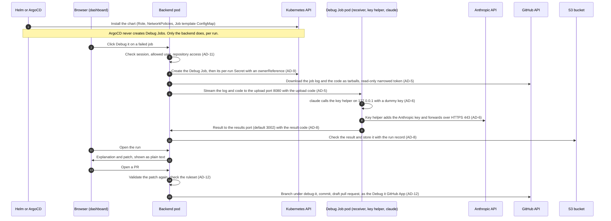

# Debug it security design

This document is for the platform owner who has to answer security questions about **Debug it**, the feature that lets Claude explain a failed GitHub Actions job and suggest a patch. It describes the code as it is on `main`: how a debug run flows, which network connections are allowed, every credential and where it lives, what leaves the cluster, which Anthropic terms apply, and how each of the seventeen safety rules (SR1 to SR17) is enforced and tested. Files are named without line numbers; search them for the names given. The setup steps are in the [README](../README.md#turn-on-debug-it). Examples use invented names: the organization acme and the repository acme/payments-api. References such as AD-5 or AD-12 are the project's architecture decision numbers, given for traceability.

The steps in words:

1. **Install.** Helm or ArgoCD installs the chart with `debugIt.enabled: true`. The chart renders the backend's Role and RoleBinding in the debug namespace, the two NetworkPolicies and the Debug Job template ConfigMap (`helm/chart/templates/debug-it.yaml`). Neither Helm nor ArgoCD ever creates a Debug Job; the backend creates one per run through the Kubernetes API, from that template, filling in only the run ID, image tag, Secret name and limits (`code/backend/src/adapters/kubernetes.ts`).
2. **Click.** A signed in user presses Debug it. The backend checks the session cookie and CSRF token, that the user is an allowed user (or an administrator), and the user's access to the repository (`code/backend/src/routes/checkChain.ts`, `code/backend/src/routes/debugIt.ts`, `code/backend/src/services/debugIt/runs.ts`). The repository, job, commit and branch come only from signed webhook records and GitHub, never from the request.
3. **Job and Secret.** When the run leaves the queue, the backend creates the Debug Job first, then one Secret owned by it holding the Anthropic key, the upload code and the result code (`code/backend/src/services/debugIt/lifecycle.ts`, `code/backend/src/adapters/kubernetes.ts`).
4. **Code and log.** The backend downloads each repository through the GitHub tarball API with a token narrowed to that repository and `contents: read, metadata: read`, and the job log with `actions: read`. It streams both, never buffered whole and never written to its disk, to the receiver container on port 8080, authenticated with the upload code (`code/backend/src/services/debugIt/downloads.ts`, `code/backend/src/services/debugIt/upload.ts`, `code/debug-job/src/receiver.ts`).
5. **Claude.** The claude container runs Claude Code with fixed arguments and only the Read, Grep, Glob and Edit tools (`code/debug-job/src/wrapper.ts`). It talks to the key helper container on 127.0.0.1:8081 with a dummy key; the key helper is the only container that holds the Anthropic key, and forwards each request to api.anthropic.com (`code/debug-job/src/keyHelper.ts`).
6. **Result.** The wrapper posts the result to the backend's separate results port (`debugIt.resultsPort`, default 3002) with the run's result code. The backend checks the code against its SHA-256, refuses a result that contains the run's key, and stores the fields as untrusted text in S3 (`code/backend/src/routes/debugItResults.ts`, `code/backend/src/services/debugIt/results.ts`).
7. **Dashboard.** The dashboard shows the explanation and patch as text nodes, never as HTML (`code/frontend/src/components/DebugRunResult.tsx`). Each time the result is read, the backend runs its patch check on the stored patch and the result view shows the outcome (`code/backend/src/services/debugIt/runs.ts`, `code/backend/src/services/debugIt/patchValidation.ts`).
8. **Open a PR.** The backend validates the patch again, checks the repository's ruleset and, as the Debug it GitHub App, creates a branch under `debug-it/`, a commit through the Git Data API and a draft pull request (`code/backend/src/services/debugIt/patchValidation.ts`, `code/backend/src/services/debugIt/patchApply.ts`, `code/backend/src/services/debugIt/fixPullRequest.ts`, `code/backend/src/adapters/githubApp.ts`).

## Main controls

The dashboard's Security page shows these eight sentences. Each one points to the safety rules that enforce it.

1. The agent reaches only the Anthropic API. See [SR3](#sr3-the-agent-reaches-only-the-anthropic-api) and [SR11](#sr11-debug-jobs-are-isolated).
2. The agent holds no GitHub, Kubernetes or cloud credential. See [SR1](#sr1-the-agent-holds-no-github-credential), [SR11](#sr11-debug-jobs-are-isolated) and [SR12](#sr12-secrets-never-leak).
3. Only the key helper container holds the Anthropic key. See [SR12](#sr12-secrets-never-leak) and [Credentials](#credentials).
4. The agent can only read, search and edit files in its own work folder. See [SR4](#sr4-repository-configuration-is-ignored) and [SR5](#sr5-the-agent-has-only-read-search-and-edit-tools).
5. Only the backend writes to GitHub, and only draft pull requests after it validates the patch. See [SR6](#sr6-only-the-backend-writes-to-github-and-only-through-open-a-pr), [SR7](#sr7-patch-validation-runs-on-the-backend) and [SR10](#sr10-fix-pull-requests-are-drafts).
6. Every check runs on the backend. See [SR13](#sr13-every-check-runs-on-the-backend).
7. No key or token appears in logs, run records or the browser. See [SR12](#sr12-secrets-never-leak).
8. Every debug run and fix pull request is recorded. See [SR15](#sr15-every-debug-run-and-fix-pull-request-is-recorded).

## Network

The chart renders two NetworkPolicies when Debug it is on (`helm/chart/templates/debug-it.yaml`): `debug-it-job` in the debug namespace, with policy types Ingress and Egress, and one on the backend pod, with policy type Ingress only. NetworkPolicies block every connection to and from a Debug Job pod that the tables below do not list, and every incoming connection to the backend pod that they do not list. The backend's outgoing connections are not limited by the chart; [README step 8](../README.md#8-allow-the-backends-egress) lists what to allow if you limit them. NetworkPolicies add up: the "Blocked" rows hold only if no other NetworkPolicy selecting those pods allows more, for example the chart's generic `networkpolicy` block (`helm/chart/templates/networkpolicy.yaml`, off by default in `helm/chart/values.yaml`).

The Anthropic API addresses come from `debugIt.network.anthropicCidrs`, default 160.79.104.0/23 and 2607:6bc0::/48 (`helm/values-backend.yaml`). The results port comes from `debugIt.resultsPort`, default 3002. Cluster DNS, frontend and ingress controller pods are matched by the labels under `debugIt.network` (`dnsNamespace`, `dnsPodLabels`, `frontendPodLabels`, `ingressControllerNamespace`, `ingressControllerPodLabels`).

NetworkPolicies do nothing unless the cluster's network plugin enforces them ([README step 9](../README.md#9-make-sure-networkpolicies-are-enforced)). Debug it therefore proves the isolation instead of trusting it (AD-7): at startup the backend runs a check Job with the Debug Job's labels, which must fail to reach github.com, api.github.com, 169.254.169.254, the Kubernetes API, the backend main port and outside DNS, and must reach Anthropic; if it fails, Debug it stays off (`code/backend/src/services/debugIt/isolation.ts`, `code/debug-job/src/isolationCheck.ts`). Before it starts Claude, the claude container repeats the forbidden-address part of that test (GitHub, the metadata address, the Kubernetes API, the backend main port, outside DNS) and exits if any answers (`code/debug-job/src/wrapper.ts`).

### Backend pod

| Direction | Peer | Port | Purpose | Limited by the chart |
| --- | --- | --- | --- | --- |
| In | Frontend pods, release namespace | main port (3001) | Dashboard API | Yes |
| In | Ingress controller pods | main port (3001) | Dashboard API, GitHub webhook | Yes |
| In | Debug Job pods, debug namespace | results port (3002) | `POST /results/{runId}` only | Yes |
| In | Anything else | any | | Blocked |
| Out | api.github.com | 443 | Debug it GitHub App calls (narrowed installation tokens) | No |
| Out | github.com | 443 | Sign in: OAuth code exchange | No |
| Out | codeload.github.com | 443 | Tarball downloads (GitHub redirects there; followed without the token) | No |
| Out | GitHub's log storage hosts | 443 | Job log downloads (GitHub redirects there; followed without the token) | No |
| Out | api.anthropic.com | 443 | Personal key check only (`GET /v1/models`) | No |
| Out | Kubernetes API | API server port | Create, watch and delete Debug Jobs; create and delete their Secrets | No |
| Out | S3 | 443 | Run records, usage, settings, personal keys, under `debug-it/` | No |
| Out | Debug Job pods, debug namespace | 8080 | Upload of log and code to the receiver | No (allowed in by the Debug Job policy) |
| Out | Cost telemetry collector | its port | Run cost and tokens, only when `debugIt.costTelemetry.enabled` | No |

The results port is a separate listener and a separate Service port that no Ingress names (`code/backend/src/routes/debugItResults.ts`, `helm/chart/templates/service.yaml`).

### Debug Job pod

| Direction | Peer | Port | Purpose |
| --- | --- | --- | --- |
| In | Backend pods, release namespace | 8080 TCP | Upload to the receiver init container |
| In | Anything else | any | Blocked |
| Out | `debugIt.network.anthropicCidrs` (default 160.79.104.0/23 and 2607:6bc0::/48) | 443 TCP | Anthropic API, from the key helper |
| Out | Cluster DNS pods (`dnsNamespace`, `dnsPodLabels`) | 53 UDP and TCP | Name lookups through cluster DNS |
| Out | Backend pods, release namespace | results port (3002) TCP | Posting the result |
| Out | Anything else (GitHub, metadata address, Kubernetes API, backend main port, other pods, the internet) | any | Blocked |
| Inside the pod | key helper on 127.0.0.1 | 8081 | claude to key helper, loopback only |

## Credentials

| Credential | Where it is stored | Who can read it | Lifetime |
| --- | --- | --- | --- |
| Debug it GitHub App private key | Kubernetes Secret in the monitor namespace (`debugIt.githubApp.privateKeySecret`); reaches the backend only as a `secretKeyRef` env var (`helm/chart/templates/_helpers.tpl`) | The backend container, which signs App JWTs with it (`code/backend/src/adapters/githubApp.ts`). Never in the debug namespace or a Debug Job | Until you rotate it in the App settings |
| Debug it GitHub App client secret | Kubernetes Secret in the monitor namespace (`debugIt.githubApp.clientSecretSecret`), `secretKeyRef` env var | The backend container, for the sign in code exchange | Until you rotate it |
| Installation tokens | Backend process memory only (cached by the @octokit/auth-app library). Each is narrowed to one repository and one step's permissions (organization lookups use `members: read`). No adapter function returns a token | The backend process | Up to 1 hour (GitHub's limit); never written to S3, logs or a Debug Job |
| User sign in token | Backend process memory, during the sign in request | The backend, which uses it once for `GET /user` to learn the user's ID and login | That one request; not stored, not put in a cookie |
| Anthropic organization key | Kubernetes Secret in the monitor namespace (`debugIt.anthropicApiKeySecret`), `secretKeyRef` env var on the backend; copied per run into the run's Secret in the debug namespace | The backend container (to copy it into each run's Secret and to refuse results that contain it); in the Debug Job only the key helper container, which mounts only that item | Until you rotate it. Each copy lives as long as its Job: the Secret is owned by the Job, the Job is removed 300 s after it ends, and a sweep every 5 minutes deletes Jobs of ended runs |
| Personal keys (personal key mode) | S3, AES-256-GCM encrypted with a fresh nonce per write, at `debug-it/personal-keys/{githubUserId}.json` (`code/backend/src/services/debugIt/personalKeys.ts`); decrypted copy per run in that run's Secret | The backend, which decrypts it when the user's run leaves the queue; in the Debug Job only the key helper | Until the user replaces or deletes it; deleting removes every stored version and cancels the user's waiting runs |
| Encryption Secret | Kubernetes Secret in the monitor namespace (`debugIt.encryptionSecret.name`) with two 32 byte keys, `personalKeyEncryptionKey` and `sessionEncryptionKey`, as `secretKeyRef` env vars | The backend container | Until you replace it |
| Session cookie `dbg_session` | The user's browser. AES-256-GCM sealed with the session key, holding only user ID, login and expiry; nothing is stored on the server (`code/backend/src/services/session.ts`) | Only the backend can open it. HttpOnly, SameSite=Lax, Secure when the public URL is https | 8 hours |
| Sign in state cookie `dbg_oauth_state` | The user's browser, during sign in | The backend, to match GitHub's callback. Same flags as the session cookie | 600 seconds, cleared after the callback |
| Upload code | 32 random bytes, made when the run leaves the queue; backend memory and the run's Secret (item `upload-code`) | The backend, and in the Debug Job only the receiver container | The run's Job |
| Result code | 32 random bytes, made with the upload code; the run's Secret (item `result-code`). The run record keeps only its SHA-256, cleared when a result is accepted or the run fails (`code/backend/src/services/debugIt/results.ts`) | In the Debug Job only the claude container (the wrapper, which posts the result; Claude's tools are denied that folder) | The run's Job |
| Telemetry collector key (optional) | Kubernetes Secret in the monitor namespace (`debugIt.costTelemetry.apiKeySecret`), `secretKeyRef` env var | The backend container, which sends it only as the `x-api-key` header to the configured endpoint, never to a redirect target (`code/backend/src/adapters/telemetry.ts`) | Until you rotate it |

The `debugIt` values accept no secret value, only Secret references (the generic chart's `secrets` block, `helm/chart/templates/secrets.yaml`, is separate and off by default). In the debug namespace, the backend's Role allows Secrets `create` and `delete` only, so the backend cannot read back or list any Secret there. The claude container's environment is built from scratch and holds only a dummy Anthropic key. The 1.x credentials (the `GITHUB_TOKEN`, the webhook secret, AWS access) are unchanged by Debug it and never reach a Debug Job.

## What leaves the cluster

- **Code and job logs, to Anthropic.** Each debug run sends the failed job's log (or, for a failed run without jobs, the workflow file and GitHub's error message) and the downloaded repository code to the Anthropic API, through the key helper. They are processed under the commercial terms of the owner of the key the run uses: the organization in organization key mode, the requester in personal key mode.
- **Run cost telemetry, only when on.** When `debugIt.costTelemetry.enabled` is true and an endpoint is set, the backend sends each finished run's cost and token counts, with the repository and requester login, to that collector (`code/backend/src/adapters/telemetry.ts`). It is off by default, and with it off no call is made.
- **Nothing else from Debug it.** The backend's other calls go to your own accounts: the GitHub API for your organization (through your Debug it GitHub App) and your S3 bucket. The personal key check (`GET /v1/models`) sends the key only, no code or log. One indirect path: cluster DNS may resolve outside names recursively, so names a Debug Job looks up can reach upstream resolvers; no Claude tool resolves names, since the agent has no network tool.

## Anthropic terms

Anthropic's Claude Code legal and compliance page, section "Authentication and credential use" (https://code.claude.com/docs/en/legal-and-compliance, read 2026-11-07), says:

> "Moreover, developers may not collect, store, or intermediate Claude.ai credentials or session tokens — sign-in to a Claude account must complete through Anthropic's own flow."

and, in the same section:

> "This does not restrict how customers provision and manage their own API keys or third-party inference provider credentials — for example, configuring an API key in a development environment, secrets manager, or machine image for use by the customer's own authorized users — provided the resulting usage is billed to the key owner under their agreement with Anthropic (or the applicable provider) and is not resold or intermediated as described above."

In short, as the dashboard's Security page says:

- Only Anthropic API keys are accepted, and Claude subscription tokens are refused. See [SR17](#sr17-only-anthropic-api-keys-are-accepted).
- Each run is billed to the owner of the key it uses.
- Code and job logs go to Anthropic under the commercial terms of the key owner.

In detail, Debug it relies on these sentences as follows:

- **Only Anthropic API keys are accepted; a Claude subscription token is refused in both key modes (SR17).** `isSubscriptionToken` recognizes the `sk-ant-oat` and `sk-ant-ort` prefixes (`code/backend/src/adapters/anthropic.ts`). A personal key that is one is refused before any call (`code/backend/src/services/debugIt/personalKeys.ts`). An organization key that is one keeps Debug it off (`code/backend/src/services/debugIt/isolation.ts`). The Debug Job's key helper sends the key only as `x-api-key`, the API key header (`code/debug-job/src/keyHelper.ts`).
- **Each run is billed to the owner of the key it uses: the organization in organization key mode, the requester in personal key mode**, as the second quote requires. The backend picks the key when the run leaves the queue, the organization key or the requester's own decrypted personal key, and puts only that key in the run's Secret (`code/backend/src/services/debugIt/lifecycle.ts`, `code/backend/src/adapters/kubernetes.ts`). The per user monthly cap (`debugIt.monthlyCap`) applies only in organization key mode (`code/backend/src/services/debugIt/runs.ts`).
- **Code and job logs go to Anthropic under the key owner's commercial terms.** The backend streams them into the Debug Job (`code/backend/src/services/debugIt/upload.ts`), and only the key helper forwards requests to api.anthropic.com (`code/debug-job/src/keyHelper.ts`).

## Safety rules SR1 to SR17

Each rule lists the files that enforce it and the Epic 7 attack test in `helm/tests/attack/` that proves it, plus unit tests where they add something. How the attack tests run in CI is under [Attack tests in CI](#attack-tests-in-ci).

## SR1. The agent holds no GitHub credential

**Rule.** The claude container has no GitHub token, no Kubernetes service account token and no cloud credential. There is no clone pod: the backend downloads the code and sends the receiver only the upload code.

**Enforced by.** `helm/chart/templates/_helpers.tpl` (Debug Job pod: `automountServiceAccountToken: false`, `enableServiceLinks: false`, each Secret item mounted only into its own container); `code/debug-job/src/wrapper.ts` (claude's environment built from scratch with a dummy key); `code/backend/src/adapters/kubernetes.ts` (the run's Secret holds only the Anthropic key, upload code and result code); `code/backend/src/services/debugIt/downloads.ts`, `code/backend/src/services/debugIt/upload.ts`.

**Proven by.** `helm/tests/attack/attack-test.sh` (claude has no key, token or cloud credential in its environment; no service account token, projected, CSI or host volume). Unit: `code/backend/tests/kubernetes.test.ts`.

## SR2. Code download is read only

**Rule.** The backend downloads code with an installation token that has only `contents: read` and `metadata: read` and covers one repository, and no GitHub token reaches the debug namespace.

**Enforced by.** `code/backend/src/adapters/githubApp.ts` (`downloadTarball` narrows the token, follows the codeload redirect without it, and returns only the commit and a stream; no adapter function returns a token); `code/backend/src/services/debugIt/downloads.ts`.

**Proven by.** `helm/tests/attack/attack-test.sh` (no GitHub token in the Debug Job's environment or mounted Secrets); `helm/tests/attack/leak-sweep.mjs` (every captured output searched for every known token). Unit: `code/backend/tests/githubApp.test.ts`.

## SR3. The agent reaches only the Anthropic API

**Rule.** From a Debug Job pod, GitHub, the cloud metadata address, the Kubernetes API, the backend main port, other pods and outside DNS resolvers are unreachable; the Anthropic API and the backend results port are reachable.

**Enforced by.** `helm/chart/templates/debug-it.yaml` (the `debug-it-job` NetworkPolicy and the backend's NetworkPolicy, see [Network](#network)); `code/backend/src/services/debugIt/isolation.ts` and `code/debug-job/src/isolationCheck.ts` (startup check Job; Debug it stays off if it fails); `code/debug-job/src/wrapper.ts` (repeats the forbidden-address probes before starting Claude). Cluster DNS may resolve outside names recursively, so a name a Debug Job looks up can reach upstream resolvers; no Claude tool resolves names, since the agent has no network tool (SR5).

**Proven by.** `helm/tests/attack/attack-test.sh` with `helm/tests/attack/probe.mjs` (probes from a pod with the Debug Job labels, and a control probe). Unit: `code/debug-job/tests/wrapper.test.ts`, `code/backend/tests/isolation.test.ts`.

## SR4. Repository configuration is ignored

**Rule.** Hooks, settings, environment blocks, MCP servers, CLAUDE.md files, agents, commands, skills and plugins in a downloaded repository are not loaded.

**Enforced by.** `code/debug-job/src/wrapper.ts`: Claude Code runs with `--restricted --strict-mcp-config --setting-sources "" --disable-slash-commands` and only the wrapper's own `--settings` file, with `ENABLE_TOOL_SEARCH=false`, `CLAUDE_CODE_DISABLE_CLAUDE_MDS=1`, `CLAUDE_CODE_DISABLE_AUTO_MEMORY=1`, and `HOME` and `CLAUDE_CONFIG_DIR` in the wrapper's state folder.

**Proven by.** `helm/tests/attack/agent-attack-test.sh` with the repository configuration fixtures in `helm/tests/attack/fixtures` (a marker-writing hook leaves no marker; no canary from repository configuration reaches Claude's requests). Unit: `code/debug-job/tests/wrapper.test.ts`.

## SR5. The agent has only read, search and edit tools

**Rule.** The agent can use only Read, Grep, Glob and Edit. It cannot run commands or fetch pages, and can read only the downloaded code and the job log, never its environment or mounted Secrets.

**Enforced by.** `code/debug-job/src/wrapper.ts` (`Read,Grep,Glob,Edit` as both `--tools` and `--allowedTools` with `--permission-mode dontAsk`; a settings file that allows Read only under the work folder and Edit only under the downloaded repositories, and denies the state and result code folders); `helm/chart/templates/_helpers.tpl` (`shareProcessNamespace: false`, the key mounted only into the key helper).

**Proven by.** `helm/tests/attack/agent-attack-test.sh` (a log telling the agent to run a command runs none; the only tool calls are Read, Grep, Glob and Edit). Unit: `code/debug-job/tests/wrapper.test.ts`.

## SR6. Only the backend writes to GitHub, and only through Open a PR

**Rule.** The only GitHub writes are the branch, commit and draft pull request of Open a PR. Each token covers one repository and only the permissions its step needs: `actions: read` for logs, `contents: read` for code, `metadata: read` for permission and ruleset lookups, `contents: write` and `pull_requests: write` for one fix pull request.

**Enforced by.** `code/backend/src/adapters/githubApp.ts` (one function per step, each with its own narrowed token; the write calls are only in `openFixPullRequest`); `code/backend/src/services/debugIt/fixPullRequest.ts` (the only caller of `openFixPullRequest`).

**Proven by.** `helm/tests/attack/github-write-attack.ts` (every token names one repository and one step's permissions; the only writes are blobs, a tree, a commit, a `debug-it/` ref and a draft pull request); `helm/tests/attack/leak-backend.ts` (the App's writes and tokens across the whole leak job). Unit: `code/backend/tests/githubApp.test.ts`.

## SR7. Patch validation runs on the backend

**Rule.** The backend refuses a patch that touches `.github/workflows` or `.git`, adds a symlink or changes a file mode, reaches outside the repository, or is over the size limit. It never runs git or writes the patch to its disk; it builds the commit through the GitHub API.

**Enforced by.** `code/backend/src/services/debugIt/patchValidation.ts` (pure; normalizes case, separators and invisible characters and checks both sides of a rename); `code/backend/src/services/debugIt/patchApply.ts` (pure in-memory applier, no git); `code/backend/src/services/debugIt/fixPullRequest.ts` (validates again at each Open a PR); `code/backend/src/adapters/githubApp.ts` (commit through the Git Data API; refuses symlinks, submodules and non-text files).

**Proven by.** `helm/tests/attack/github-write-attack.ts` (each patch rule sent straight to the route is refused with no GitHub request). Unit: `code/backend/tests/patchValidation.test.ts`, `code/backend/tests/patchApply.test.ts`.

## SR8. The Debug it GitHub App has only the permissions it needs

**Rule.** The App needs contents write, pull requests write, actions read, metadata read and organization members read, never workflows or administration. The backend uses only the configured organization's installation and keeps Debug it off if a forbidden permission is granted.

**Enforced by.** `code/backend/src/adapters/githubApp.ts` (`checkInstallation` refuses `workflows`, `administration` and `organization_administration`, and a suspended installation; only the configured organization's installation is used); `code/backend/src/services/debugIt/isolation.ts` (Debug it stays off when the check fails).

**Proven by.** `helm/tests/attack/github-write-attack.ts`, which runs the real adapter against the test App and checks that every token it mints names one repository and one step's permissions, and that GitHub lists only that repository for it. The startup refusal of a forbidden permission is proven by unit tests, since the attack tests do not install an over-privileged App: `code/backend/tests/githubApp.test.ts`, `code/backend/tests/isolation.test.ts`.

## SR9. The Debug it GitHub App cannot push to the default branch or merge

**Rule.** The backend never calls a merge API and writes refs only under `debug-it/`. Before each fix pull request it checks that an active ruleset on the default branch blocks the App (an `update` rule, or a `pull_request` rule with at least one approval, with no bypass for the App); classic branch protection does not count. A repository without such a ruleset gets no fix pull request. The README recommends a ruleset with two approvals, because once a person approves, a one-approval ruleset no longer blocks a merge by the App.

**Enforced by.** `code/backend/src/adapters/githubApp.ts` (`checkRuleset`; refs only under `debug-it/`); `code/backend/src/services/debugIt/fixPullRequest.ts` (refuses unless the ruleset check answers protected).

**Proven by.** `helm/tests/attack/github-write-attack.ts` (with an App token narrowed like Open a PR's, a push to the default branch and a merge both fail on the test repository; the test repository without a ruleset gets no fix pull request). Unit: `code/backend/tests/githubApp.test.ts`, `code/backend/tests/fixPullRequest.test.ts`.

## SR10. Fix pull requests are drafts

**Rule.** Every fix pull request is opened as a draft.

**Enforced by.** `code/backend/src/adapters/githubApp.ts` (the only pull request creation sends `draft: true`).

**Proven by.** `helm/tests/attack/github-write-attack.ts` and `helm/tests/attack/leak-backend.ts` (the opened pull request is a draft on GitHub). Unit: `code/backend/tests/githubApp.test.ts`.

## SR11. Debug Jobs are isolated

**Rule.** The debug namespace never holds the Debug it GitHub App key, and holds an Anthropic key only inside per-run Secrets, each of which lives until its Job is deleted (300 s after the Job ends, or at the next 5-minute sweep). Each Debug Job mounts only its own Secret, deleted with it; the key is mounted only into the key helper, never into the claude container. The backend can create and delete Secrets there but not read or list them.

**Enforced by.** `helm/chart/templates/debug-it.yaml` (Role: Jobs create, get, list, watch, delete; Pods get, list, watch; Secrets create and delete only); `code/backend/src/adapters/kubernetes.ts` (Job first, then one Secret with an ownerReference to it); `helm/chart/templates/_helpers.tpl` (each Secret item in its own volume, mounted into one container; the App key only as a `secretKeyRef` on the backend in the monitor namespace); `code/backend/src/services/debugIt/lifecycle.ts` (5-minute sweep of Jobs of ended runs).

**Proven by.** `helm/tests/attack/attack-test.sh` (two runs at once: each pod mounts only its own Secret, the key helper mounts only the Anthropic key, claude mounts only the result code, and the backend's account cannot get or list Secrets in either namespace). Unit: `code/backend/tests/kubernetes.test.ts`.

## SR12. Secrets never leak

**Rule.** No API key, token, code or App key appears in logs, run records, results, telemetry or anything sent to the browser. Personal keys are encrypted at rest. The backend refuses a result that contains the run's key.

**Enforced by.** `code/backend/src/services/debugIt/results.ts` and `code/backend/src/routes/debugItResults.ts` (refuse a result holding the key, raw or JSON-decoded; fail closed in personal key mode when the key is gone or was replaced; keep only the result code's SHA-256); `code/backend/src/services/debugIt/personalKeys.ts` (AES-256-GCM with a fresh nonce and the object key as additional data); `code/debug-job/src/keyHelper.ts` and `code/debug-job/src/wrapper.ts` (fixed log lines only, no header values); `code/backend/src/adapters/githubApp.ts` (fixed error sentences); `code/backend/src/adapters/telemetry.ts` (sends only cost, tokens, repository and login); `helm/chart/templates/_helpers.tpl` (no secret value in Helm values, only `secretKeyRef`).

**Proven by.** `helm/tests/attack/leak-attack-test.sh` with `helm/tests/attack/leak-backend.ts` and `helm/tests/attack/leak-sweep.mjs` (every known key, token and code, and their encodings, absent from run records, results, backend and Debug Job logs, telemetry and API answers; the stored personal key is not the plain key); `helm/tests/attack/agent-attack-test.sh` (a log telling the agent to print its key produces a result without it). Unit: `code/backend/tests/results.test.ts`, `code/debug-job/tests/keyHelper.test.ts`.

## SR13. Every check runs on the backend

**Rule.** Every Debug it, run progress, result, feedback, Open a PR and settings call is refused without a session, for a user who is not allowed, or without the needed repository access. Open a PR checks, with fresh GitHub lookups, read access to every repository of the run and write access to the target.

**Enforced by.** `code/backend/src/routes/debugIt.ts` (session and CSRF on the whole `/debug-it` router); `code/backend/src/routes/checkChain.ts` (allowed user or administrator, then repository permission, failing closed); `code/backend/src/routes/debugItRuns.ts` (Open a PR guards); `code/backend/src/services/debugIt/runs.ts` (targets only from signed webhook records and GitHub; joining a running target checks read on every repository of that run); `code/backend/src/routes/alertSettingsGate.ts` (alert settings writes need an administrator).

**Proven by.** `helm/tests/attack/leak-backend.ts` (authorization matrix of every Debug it route: no session, not allowed, no repository access). Unit: `code/backend/tests/checkChain.test.ts`, `code/backend/tests/debugItRuns.test.ts`, `code/backend/tests/fixPullRequest.test.ts`.

## SR14. Log and code content cannot redirect the fix

**Rule.** Nothing in a log, the code or Claude's answer can change which repository, commit or branch a fix pull request targets.

**Enforced by.** `code/backend/src/services/debugIt/fixPullRequest.ts` (repository, commit, base and branch only from the run record and the validated patch); `code/backend/src/routes/debugItRuns.ts` (the repository comes only from the stored download matched by the path; no request body is read).

**Proven by.** `helm/tests/attack/agent-attack-test.sh` with `helm/tests/attack/fix-target.ts` (a log and repository telling the agent to target another repository or branch change nothing). Unit: `code/backend/tests/fixPullRequest.test.ts`.

## SR15. Every debug run and fix pull request is recorded

**Rule.** Each run has a record with requester, times, repository, target, job and outcome, and each fix pull request is added to it.

**Enforced by.** `code/backend/src/services/debugIt/runs.ts` (record created before the run is tracked); `code/backend/src/services/debugIt/lifecycle.ts` (one `[AUDIT]` line per state change; records kept 30 days, never one from the current month); `code/backend/src/services/debugIt/fixPullRequest.ts` (each fix pull request appended by a conditional write and logged).

**Proven by.** `helm/tests/attack/leak-backend.ts` (a complete run record for every run and fix pull request of the job). Unit: `code/backend/tests/lifecycle.test.ts`, `code/backend/tests/fixPullRequest.test.ts`.

## SR16. The dashboard resists hostile text and forged requests

**Rule.** Results are shown as plain text, the dashboard sends a content security policy that blocks inline scripts and outside requests, and every state-changing call needs a CSRF token.

**Enforced by.** `code/frontend/src/components/DebugRunResult.tsx` (text nodes only, no `dangerouslySetInnerHTML`); `docker/nginx.conf` (`default-src 'self'; script-src 'self'; connect-src 'self'` on every location); `code/backend/src/routes/checkChain.ts` (CSRF token, an HMAC of the session cookie, checked on every non-safe method); `code/frontend/src/services/api.ts` (sends it as `X-CSRF-Token`); `code/backend/src/services/session.ts` (HttpOnly, SameSite=Lax cookie); `code/backend/src/services/debugIt/fixPullRequest.ts` (fix pull request body strips HTML, mentions and closing keywords).

**Proven by.** `helm/tests/attack/browser-attack.mjs` (in Chromium, an explanation holding a script tag and an outside image runs no script and makes no outside request; a state change without the CSRF token is refused). Unit: `code/backend/tests/nginxCsp.test.ts`, `code/frontend/src/DebugRunResult.test.tsx`.

## SR17. Only Anthropic API keys are accepted

**Rule.** In both key modes the backend refuses a Claude subscription token, because Anthropic's terms say developers may not "collect, store, or intermediate Claude.ai credentials or session tokens" (see [Anthropic terms](#anthropic-terms)).

**Enforced by.** `code/backend/src/adapters/anthropic.ts` (`isSubscriptionToken`: the `sk-ant-oat` and `sk-ant-ort` prefixes); `code/backend/src/services/debugIt/personalKeys.ts` (personal key refused before any call); `code/backend/src/services/debugIt/isolation.ts` (an organization key that is one keeps Debug it off); `code/debug-job/src/keyHelper.ts` (sends only `x-api-key`).

**Proven by.** The refusal itself is proven by unit tests: `code/backend/tests/anthropic.test.ts`, `code/backend/tests/personalKeys.test.ts`, `code/backend/tests/isolation.test.ts`. On the attack-test side, `helm/tests/attack/oauth-key-helper.mjs` shows the boundary: the agent and leak attack jobs drive real Claude Code with the maintainer's subscription token, which the product refuses, so they swap the shipped key helper for this test-only one inside their own Debug Jobs. It is never shipped in an image or the chart.

## Attack tests in CI

The Epic 7 attack tests live in `helm/tests/attack/` and run from the reusable workflow `.github/workflows/attack-tests.yml`, in four jobs: `isolation` (`attack-test.sh`: network, Secrets, RBAC, in a kind cluster with Calico so NetworkPolicies are enforced), `agent` (`agent-attack-test.sh`: real Claude Code against hostile logs and repositories), `github` (`github-write-attack.ts`: real GitHub with a test Debug it GitHub App) and `leak` (`leak-attack-test.sh`, `leak-backend.ts`, `browser-attack.mjs`, `leak-sweep.mjs`).

- **Pull requests.** `.github/workflows/pr-validate.yml` calls it as its `attack-tests` job. A failure fails PR Validate, and the `main` ruleset requires these checks, so the pull request cannot merge. The attack tests run only for pull requests from this repository's own branches that change `code/backend`, `code/debug-job`, `code/frontend`, `helm`, `docker/Dockerfile.backend`, `docker/Dockerfile.frontend`, `docker/nginx.conf`, the attack and PR Validate workflows or `.github/actions/attack-cluster`. Otherwise, and for every fork pull request (which gets no secrets), the four checks report skipped. A skipped check counts as passed, so such a pull request can merge without the attack tests having run; only Release Publish always runs them.
- **Releases.** `.github/workflows/release-publish.yml` always runs them, and its `publish` job needs them: no image, tag or GitHub Release is published unless all four jobs pass.

The `agent` and `leak` jobs use a Claude subscription token only through the test-only `helm/tests/attack/oauth-key-helper.mjs`, as described under SR17; the product refuses such tokens.

## Turning it off

`debugIt.enabled` is `false` by default (`helm/values-backend.yaml`). With it false, none of the above runs: the chart renders no Debug it object (every Debug it template is guarded by `debugIt.active` in `helm/chart/templates/_helpers.tpl`), and the backend starts no Debug it router, results port, lifecycle or isolation check (`code/backend/src/index.ts`, `code/backend/src/routes/debugIt.ts`, `code/backend/src/routes/debugItResults.ts`). The dashboard, API and alerts behave exactly as 1.x (NFR3).
